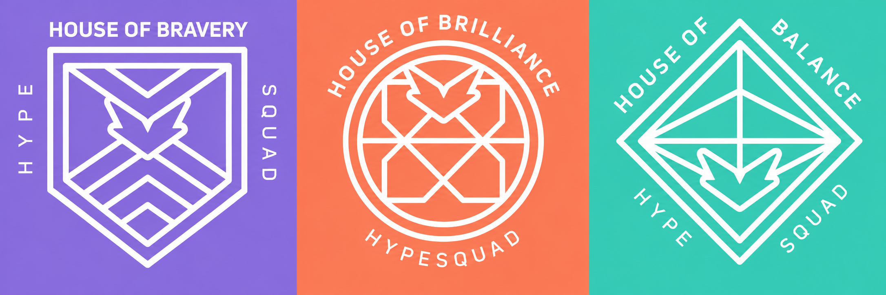

# HypeSquad Badge Bot


Self-service HypeSquad panel for Discord claim, switch, and remove badges with verified results, no false success messages.

**Warning :** read the [Disclaimer](#disclaimer) before using this bot.



## Features

- **Panel** — banner lokal + dropdown bersih, tanpa embed (Admin only via `/panel`)
- **Claim badge** — Bravery, Brilliance, Balance
- **Remove badge terverifikasi** — cek ulang `public_flags` sebelum klaim sukses (anti sukses palsu)
- **Status streaming Twitch** — status bot ungu + teks deskripsi
- **Emoji SVG sendiri** — 5 SVG di `images/` di-upload ke server sebagai emoji

## Setup

```bash
# 1. Install dependencies
npm install

# 2. Isi .env (lihat tabel Environment Variables)

# 3. Upload 5 emoji dari images/ ke server (butuh 5 slot kosong)
npm run upload

# 4. Jalankan bot
npm start
```

Lalu kirim slash command `/panel` di channel target. Slash command belum terdaftar? Jalankan `npm run deploy`.

## Environment Variables

| Variable | Required | Description |
| --- | --- | --- |
| `TOKEN` | Yes | Token bot (Developer Portal) |
| `CLIENT_ID` | Yes | Application ID, untuk `npm run deploy` |
| `GUILD_ID` | Yes | ID server (slash command + upload emoji) |
| `CHANNEL_ID` | No | Auto-kirim panel ke channel ini saat bot ready |
| `TWITCH_URL` | No | Link Twitch -> status ungu. Harus domain `twitch.tv` |
| `STREAMING_TEXT` | No | Teks streaming, default `Streaming on Twitch` |

```env
TOKEN=
CLIENT_ID=
GUILD_ID=
CHANNEL_ID=
TWITCH_URL=
STREAMING_TEXT=
```

**Note:** jangan commit `.env` (sudah di `.gitignore`) — token = kontrol penuh atas bot kamu.

## Commands

| Command | Akses | Deskripsi |
| --- | --- | --- |
| `/panel` | Administrator | Kirim banner + dropdown ke channel |

## Troubleshooting

| Gejala | Solusi |
| --- | --- |
| `30008` saat `npm run upload` | Slot emoji penuh (100), hapus emoji lama lalu upload ulang |
| Badge tidak berubah / `401` | Token tidak valid — paste ulang token dengan utuh |
| Emoji di panel tidak muncul | Belum `npm run upload` atau quota penuh (bot tetap jalan dengan emoji fallback) |
| Status tidak ungu | `TWITCH_URL` kosong / bukan `twitch.tv` — isi lalu restart |

## Disclaimer

Bot ini memproses token akun Discord yang ditempel pengguna di modal token = akses penuh ke akun, jangan pernah bagikan ke pihak yang tidak dipercaya. Memakai endpoint API internal Discord di luar jalur resmi bisa melanggar [Discord Terms of Service](https://discord.com/terms) dan berisiko limitasi/banned akun. Disediakan untuk tujuan edukasi, penggunaan sepenuhnya risiko kamu sendiri.

## License

MIT — Author : **Natan**
